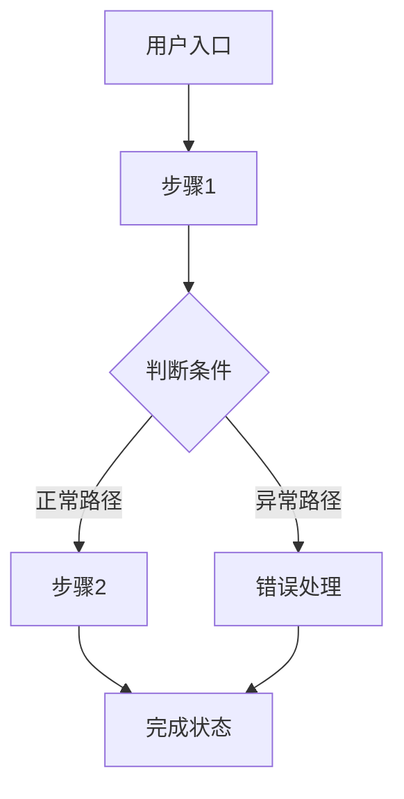

# PRD-{{需求名称}}

> 本文档为 <项目名称> 的产品需求文档，面向开发者，描述功能需求与页面内容。

## 1. 修订记录

| 版本 | 日期 | 作者 | 关联文档 | 修改说明 |
|------|------|------|----------|----------|
| V1.0 | {{yyyy-MM-dd}} | {{作者}} | 01_prd_{{需求名称}}_{{页面名称}}.md | 初始版本 |

## 2. 需求概述

简要说明需求的背景、要解决的核心问题，以及预期的业务价值。

## 3. 目标用户与使用场景

### 3.1 用户画像

| 用户角色 | 核心诉求 |
|----------|----------|
| {{角色1}} | {{诉求}} |
| {{角色2}} | {{诉求}} |

### 3.2 典型场景

列举 2-3 个具体场景，描述「谁在什么情况下用，做什么动作，期望得到什么结果」。

## 4. 核心用户动线

用 Mermaid 流程图覆盖主流程 + 异常分支（失败、无权限等）。



## 5. 功能清单

```
{{需求名称}}
├── {{功能模块}}
│   ├── {{子功能}}
│   └── {{子功能}}
├── {{功能模块}}
│   └── {{子功能}}
└── {{功能模块}}
    ├── {{子功能}}
    └── {{子功能}}
```

### 5.x {{功能模块名称}}

**功能描述**：该功能解决什么问题，核心逻辑是什么。

#### 5.x.x {{子功能名称}}

**功能描述**：

## 6. 非功能性需求

| 类别 | 要求 |
|------|------|
| 性能要求 | 首屏加载 < {{2}}s，核心接口响应 < {{500}}ms |
| 权限控制 | {{哪些角色可用，是否需要登录}} |
| 兼容性 | {{桌面端/移动端，目标浏览器及版本}} |
| 数据安全 | {{敏感字段加密传输/存储要求}} |
| 存储限制 | {{数据保留时长，单用户/全平台容量上限}} |

## 7. 页面清单

| 编号 | 页面名称 | 页面路径 | 对应文档 |
|------|----------|----------|----------|
| 01 | {{页面名}} | {{UI界面点击路径}} | 01_prd_{{需求名称}}_{{页面名称}}.md |
| 02 | {{页面名}} | {{UI界面点击路径}} | 02_prd_{{需求名称}}_{{页面名称}}.md |
